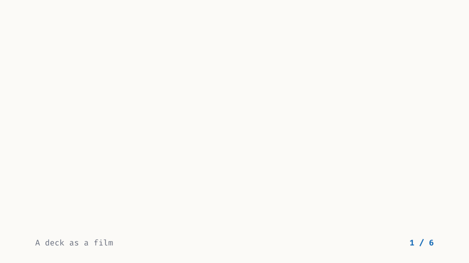

# Hi!

<!-- Both pictures follow the viewer's light or dark GitHub theme. -->
<picture>
  <source media="(prefers-color-scheme: dark)" srcset="cloud-dark.svg">
  
</picture>

<picture>
  <source media="(prefers-color-scheme: dark)" srcset="flipcard-dark.gif">
  
</picture>
