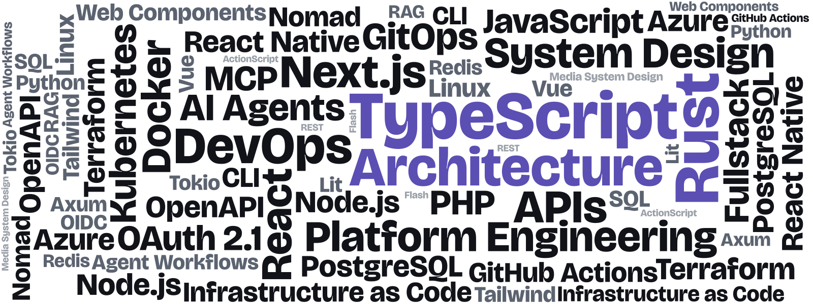

# Hi!  👋

<!-- For the README of mborejdo/mborejdo. Light/dark follows the viewer's GitHub theme. -->
<picture>
  <source media="(prefers-color-scheme: dark)" srcset="cloud-dark.svg">
  
</picture>
